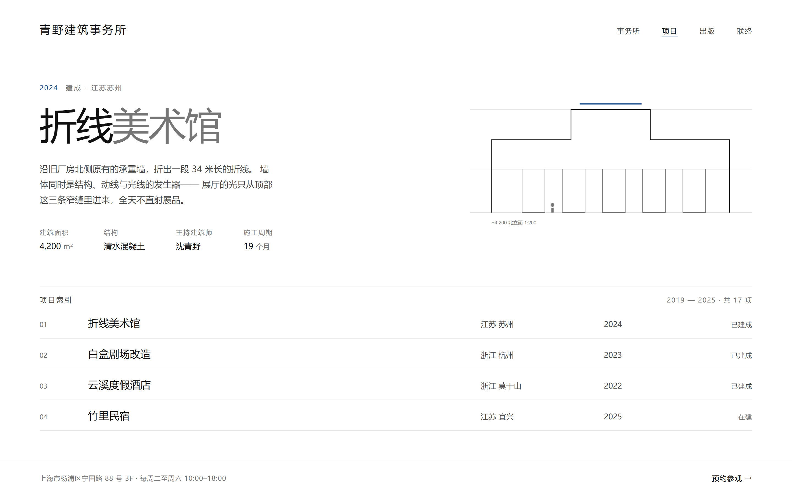
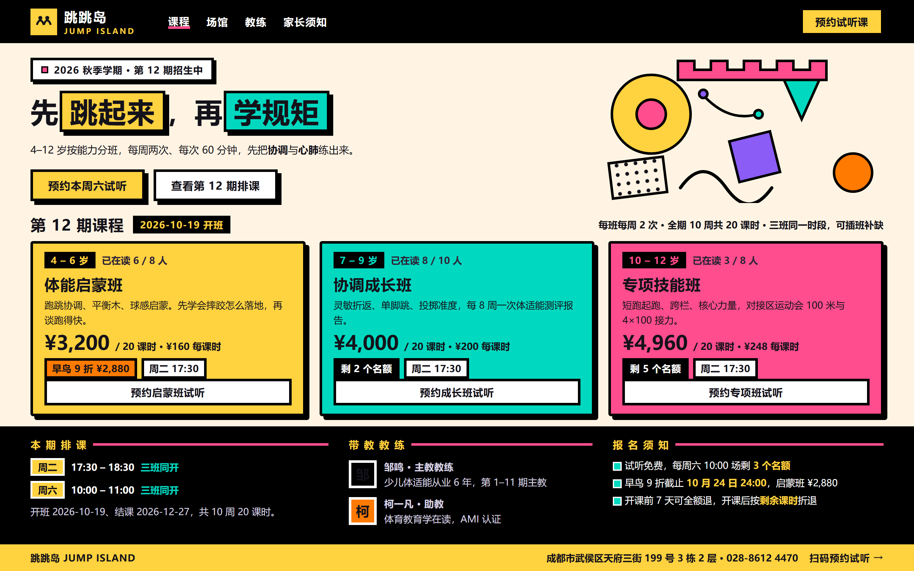
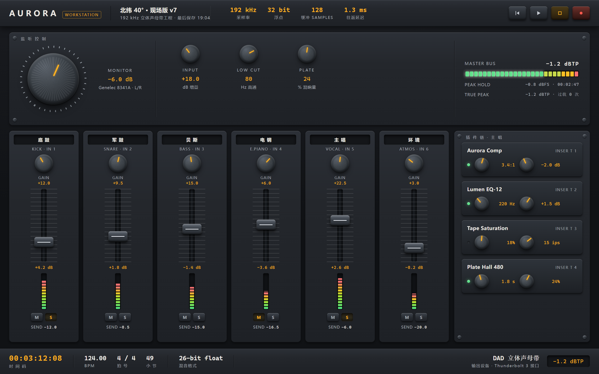
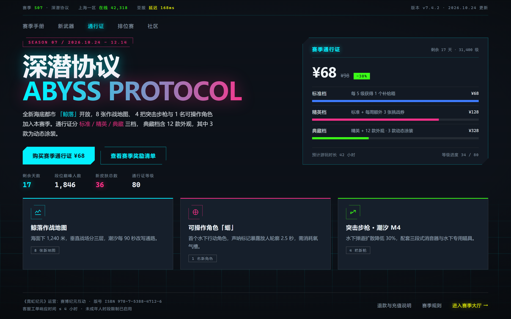
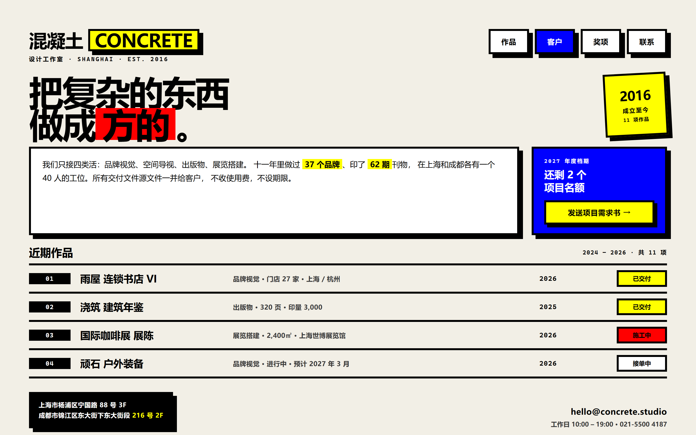
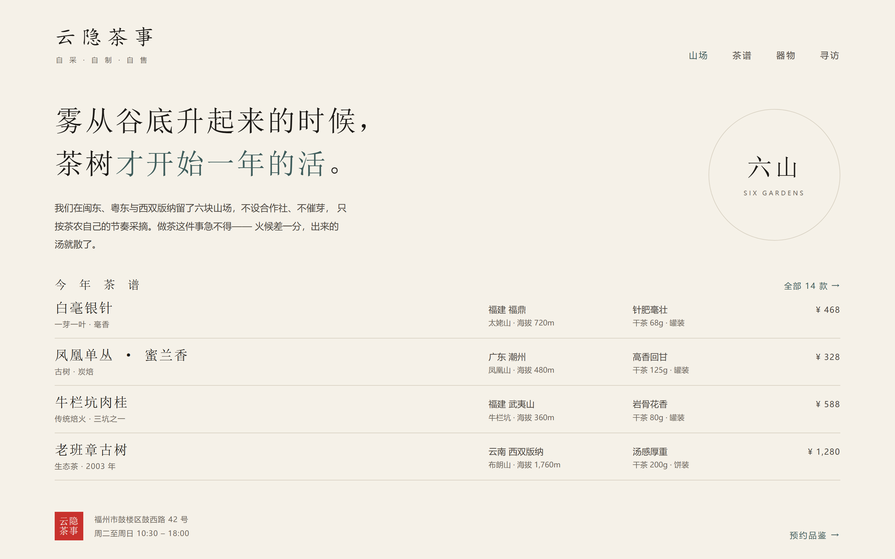

# design-iron-rules

> 应用界面设计铁律 · 8 族 25 式风格的选型、token 落值与走查体系

给 AI 装一套**可执行**的设计约束：不让它现编色值、不让它凭感觉定时长、不让它在发散阶段拿评分表卡你。

---

## 这个 skill 解决什么

用 AI 做界面设计时，有三件事最容易翻车：

| 翻车点 | 后果 | 本 skill 的做法 |
|---|---|---|
| **现编色值** | `#4F46E5` 配白字看着挺好，实际对比度可能不达标 | 14 套实测配色，`on-*` 配对 56 组全部通过校验 |
| **凭感觉选风格** | 用户说"科技感"，AI 猜成赛博朋克，结果商品图全被霓虹污染 | 按**渲染逻辑**分 8 族，决策树选型 + 禁用场景硬拦截 |
| **手算对比度 / 定时长** | WCAG 相对亮度公式极易算错，十几组配色必漏 | `contrast.js` 纯 Node 实现，支持批量校验 |

核心原则一句话：**数据提供数值，规则守住底线，风格负责美感。**

---

## 核心机制

### 一、三层约束模型

上层压下层，冲突时铁律优先于风格偏好。

| 层 | 名称 | 可否协商 | 内容 |
|---|---|---|---|
| **L0** | 铁律（10 条） | 否 | 可读性、可达性、状态完备、不丢数据、反馈即时等 |
| **L1** | 定律 | 书面说明后调整 | 间距/字号/行高/圆角/阴影/栅格/色彩的数值表 |
| **L2** | 风格宪法 | 是 | 选定风格的「必须 / 禁止」清单 |

铁律 10 条，每条都能落到具体数值和具体位置。风格偏好、审美主张、客户要求都不能豁免 L0；确有冲突时按流程报告并给两个可选方案。

### 二、三档响应模式

**开工第一步是判断模式，不是走流程。** 模式由任务规模自动判断，不额外打断用户。

| 模式 | 触发 | 输出 |
|---|---|---|
| **轻量** | 单点修改、只要一个值 | 直接回答，不出章节文档 |
| **标准** | 新做、改版、出规范 | 6 章《界面设计规格》 |
| **评审** | 走查、评审、打分 | 问题清单 + 评分，不重画稿 |

另外：**探索阶段免评分**。"给我几个方向""先看看有什么风格"这类发散请求照常走选型与 token，但不打分——早期方案天然只有 60–70 分，套评分表会被误判成"方案不匹配"而返工重来。

---

## 安装

把整个目录放进 skills 目录，`SKILL.md` 保持在根层级：

```powershell
Copy-Item -Recurse design-iron-rules "$env:USERPROFILE\.minimax\skills\design-iron-rules"
```

重启后可用。触发词：`设计规范`、`UI 走查`、`定个风格`、`配色方案`、`这设计很丑`、`design system`、`做个好看的界面`。

---

## 快速上手

**问一句色值能不能用**（轻量模式）

```
> #4F46E5 配白字行不行？
```
→ 直接跑脚本给结论，不输出六章节文档。

**定一套风格**（标准模式）

```
> 帮我给校园二手交易小程序定个风格，年轻人用，首页是商品瀑布流 + 搜索，
> 设计师说要有科技感但别太土。
```
→ 决策树排除族 5 赛博朋克（霓虹会污染商品图），落 **4.1 玻璃拟态 + 2.1 经典扁平**：顶部分类导航用玻璃态传达层级，商品卡保持纯色扁平保证识别度。输出完整规格。

**评审现有设计**（评审模式）

```
> 评审一下这个后台管理系统的设计。
```
→ 只出问题清单（位置 / 违反哪条铁律 / 建议改法）+ 总分 + 三条最高优先级返工项，不重画稿。

---

## 内置数据

| 目录 | 规模 | 检索 |
|---|---|---|
| `style-attributes.csv` | **25 式**风格 · 禁用场景 / 性能成本 / 无障碍风险 | `catalog.js style "科技"` |
| `palette-presets.csv` | **14 套**配色 · 56 组 `on-*` 配对实测达标 | `catalog.js palette "校园"` |
| `motion-presets.csv` | **22 条**动效预设 · 强度分级与禁忌 | `catalog.js motion "悬停"` |
| `ux-rules.csv` | **55 条** UX 规则 · 严重度排序 + 正反例 | `catalog.js ux "焦点"` |

数据目录提供数值，**不替代决策**——风格选型与取舍仍由决策树和 L0 铁律负责。

---

## 脚本

纯 Node.js 内置模块实现，**无第三方依赖**，跨平台通用。

```bash
# 对比度校验
node scripts/contrast.js "#111827" "#F7F8FA" 15 400     # 前景 背景 字号 字重
node scripts/contrast.js --batch pairs.txt               # 批量，每行 前景,背景,标签

# 数据检索
node scripts/catalog.js style "科技"
node scripts/catalog.js palette "校园"
node scripts/catalog.js motion "悬停"
node scripts/catalog.js ux "焦点"
node scripts/catalog.js verify                           # 校验全部 56 组配色配对
```

批量模式未达标会返回非零退出码，可直接接 CI。

> PowerShell 下若出现中文乱码，用 `Get-Content -Encoding UTF8` 读取，不要用系统默认编码。

---

## 8 族 25 式

按**渲染方式**分族，而不是按"长得像不像"。玻璃拟态和孟菲斯撞色是两个极端，却常被一起归进"现代风"；按渲染逻辑分族后，同族可自由混搭，跨族才需判断取舍。

| 族 | 渲染逻辑 | 风格 |
|---|---|---|
| **1 秩序理性** | 网格与排版驱动一切 | 瑞士极简 · 编辑杂志 · 暗黑优先 · 专业高密度 |
| **2 扁平几何** | 纯色块与几何形状 | 经典扁平 · Material You · 孟菲斯撞色 |
| **3 触感拟物** | 阴影模拟真实体积 | 新拟态 · 黏土风 · 写实拟物 · 有机自然 |
| **4 光学透明** | 模糊与透光 | 玻璃拟态 · 液态玻璃 · 极光渐变 |
| **5 未来复古** | 时代符号叠加 | 赛博朋克 · 终端 TUI · Y2K 千禧 |
| **6 粗野原始** | 暴露结构本身 | 粗野主义 · 反设计/故障 |
| **7 文化地域** | 传统材质与纹样 | 新中式/东方极简 · 复古印刷 · 纸感手作 |
| **8 品牌驱动** | 品牌符号优先 | 大字排版 · 3D 插画吉祥物 · 品牌动效 |

每式都带 `do_not_use_for` 禁用场景。命中禁用场景时 skill 会**直接说明不匹配并给替代方案**，而不是硬做。

---

## 设计 Demo

**8 族 25 式，每式一个真实场景的完整页面。** 打开 [`gallery.html`](gallery.html) 看全部 25 式画廊。

下面挑 6 张，覆盖 6 个族、视觉跨度最大的一组：

<table>
<tr>
<td width="50%"><br><b>1.1 瑞士极简</b> · 青野建筑事务所官网<br><sub>无阴影无渐变、白占 90%、强调色仅 2%</sub></td>
<td width="50%"><br><b>2.3 孟菲斯撞色</b> · 跳跳岛少儿体能馆<br><sub>撞色块 4px 黑描边 + 6px 硬阴影全局统一</sub></td>
</tr>
<tr>
<td><br><b>3.3 写实拟物</b> · Aurora 专业音频工作站<br><sub>旋钮滚花、推子凹槽、Master 总线 LED 分段表</sub></td>
<td><br><b>5.1 赛博朋克</b> · 霓虹纪元第七赛季<br><sub>霓虹只上标题与描边，正文保持纯净不发光</sub></td>
</tr>
<tr>
<td><br><b>6.1 粗野主义</b> · 混凝土设计工作室<br><sub>全局零圆角、8px 硬阴影、原色块直接上</sub></td>
<td><br><b>7.1 新中式</b> · 云隐茶事品牌主页<br><sub>宋/楷/黑三级分工，避开「廉价国潮」四件套</sub></td>
</tr>
</table>

**这些 demo 同时是 skill 的实战验证，不是装饰图。** 每个页面都是单文件自包含 HTML，
用该风格自己 `references/style-XX-*.md` 里定义的 token 落地，正文对比度经 `contrast.js` 实测达标。

内容也是真的：磐石终端里的 IF2612/中证1000 是真实股指期货合约，
Aurora 的 RS 6+3 纠删码与 quorum p99 来自真实分布式存储，
潮汐播放页 9 首歌的时长合计精确到 37 分 33 秒。

```bash
node scripts/shoot.js          # 用系统 Edge 全量重出图，零依赖
```

---

## 目录结构

```
design-iron-rules/
├── SKILL.md                      # 主入口
├── gallery.html                  # 25 式风格画廊（浏览器直接打开）
├── data/                         # 4 份数据目录（可被脚本检索）
├── demos/                        # 25 式设计 demo 源码，单文件自包含 HTML
├── assets/previews/              # demo 截图，1440×900 @2x
├── scripts/
│   ├── contrast.js               # 对比度校验（单条 / 批量）
│   ├── catalog.js                # 风格/配色/动效/UX 规则检索
│   └── shoot.js                  # 批量渲染 demo 截图（调用系统 Edge）
└── references/                   # 21 个按需加载的参考文件（20 份文档 + design-tokens.css）
    ├── iron-rules-core.md        # L0 铁律 10 条 + L1 定律数值表
    ├── style-taxonomy.md         # 8 族谱系 + 口语映射词典 + 决策树
    ├── style-01..08-*.md         # 8 族风格详解
    ├── tokens-color.md           # 色彩 token
    ├── tokens-typography-spacing.md
    ├── design-tokens.css         # 可直接引入的 CSS 变量
    ├── states-feedback.md        # 5 态 + 边界清单
    ├── accessibility.md          # 无障碍细则
    ├── anti-patterns.md          # 已知翻车模式
    ├── component-checklist.md    # 组件铁律检查表
    ├── review-scorecard.md       # 100 分走查表
    ├── design-systems.md         # 对接现有设计系统
    ├── units-and-platforms.md    # rpx / pt / rem 换算
    └── motion.md
```

参考文档按需加载，不一次性灌进上下文。

---

## 设计取舍 · 这个 skill 刻意不做什么

约束不是越多越好。以下是几条明确写进规则里的**减负决定**：

1. **不在探索阶段打分**——评分表是收敛工具，用在发散阶段会导致早期方案被误判返工
2. **不强制单一主操作**——「每屏只有一个 CTA」是默认做法而非铁律；命令面板、多入口落地页等场景允许并列主动作，只要权重可辨、文案是动词短语
3. **不管代码层硬编码**——组件库 API、CSS 写法、构建配置属于代码实现，不在本 skill 范围也不计分
4. **不把审美偏好当缺陷**——返工优先级里「审美偏好」永远排最后；评分表明确写了：若审美问题占据大部分意见，说明评分被倒置了
5. **不产出像素稿**——只出规格与约束，视觉资产交给图像生成工具
6. **跨族混搭默认 2 族而非硬上限**——超过时要求说明渲染逻辑如何自洽，而不是数到 2 就停

---

## 不适用

- 纯代码实现细节（组件库 API、CSS/框架写法、构建配置）
- 图片素材生成
- 需要像素级稿图的场景（本 skill 出规格，不出图）

---

## License

MIT
